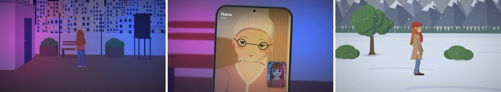
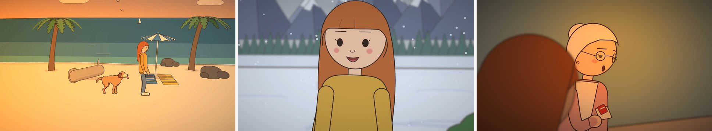

# Drawn Films

**Hand-drawn animated films from your own stories, made with your own Claude.**

You tell Claude Code a story. Claude writes the screenplay and directs it shot by shot; the Drawn Films server
draws every shot, voices the characters, scores the music, adds the sound effects and renders a 1080p video.
No drawing, no editing, and no AI images: every frame is drawn by the engine's own code.

This is the plugin for the **Drawn Films app** ([drawnfilms.com](https://drawnfilms.com)). It needs a Drawn Films
account; there's nothing else to install.




*Shots from "Someday Isn't a Day", made with Drawn Films: the Realistic look above, Simple below.*

## What it does

- **Two looks:** Simple (clean outlines and flat colour) and Realistic (fuller faces, light and shade). Simple
  also comes clean, hand-drawn or as a pencil line drawing.
- **A cast:** 37 ready people (children, teens, adults, grandparents), pets and a narrator,
  customised in the app: clothes, hair, hats and colours.
- **A director's eye:** wide shots, close-ups on every line, camera moves, cuts on action, lighting and weather,
  transitions, and one big cinematic moment where the story needs it.
- **They really talk:** every line is voiced (your own ElevenLabs key) and lip-synced, with laughs and sound
  effects, over music made for the film's feelings.
- **When the story needs something new:** Claude makes objects, places, costumes and gestures from parts, draws
  them for you to check, and keeps them for every film.
- **A thumbnail:** one big face, one strong feeling and 1 to 3 words, drawn in the film's own look.

## Get started

**You need:** a Drawn Films account, Claude Code with a Claude Pro or Max plan (the Claude desktop app's Code tab,
or a terminal), and an ElevenLabs key for the voices (your own credits).

1. In the app (app.drawnfilms.com): **Settings**, then **Connections**. Make your Drawn Films key and add your
   ElevenLabs key there.
2. Add the plugin list. Ask Claude Code to run it, or run it in a terminal:

   ```
   claude plugin marketplace add Daydremr/drawn-films-plugin
   ```

3. Install the plugin:
   - **Desktop app:** click **+** next to the prompt box, then **Add plugins**. On **Discover**, pick
     **drawn-films** in the filter next to Search, then install **Drawn Films app**.
   - **Terminal:** `/plugin install drawn-films-app@drawn-films`.

   It asks for your Drawn Films key. The key is kept in your computer's credential store, never in a chat.

4. Start a new Claude Code session and tell it a story:

   > Make a short animated film: a girl finds her late grandmother's recipe book and cooks for her family for
   > the first time.

Your finished films are in the app, under **Films**.

## Using it for money

Go ahead. The films you make are yours, for anything: a monetised YouTube channel, ads, paid work for clients.

## Licence

These files are for use with a Drawn Films account only ([LICENSE](LICENSE)). The films you make are yours.
